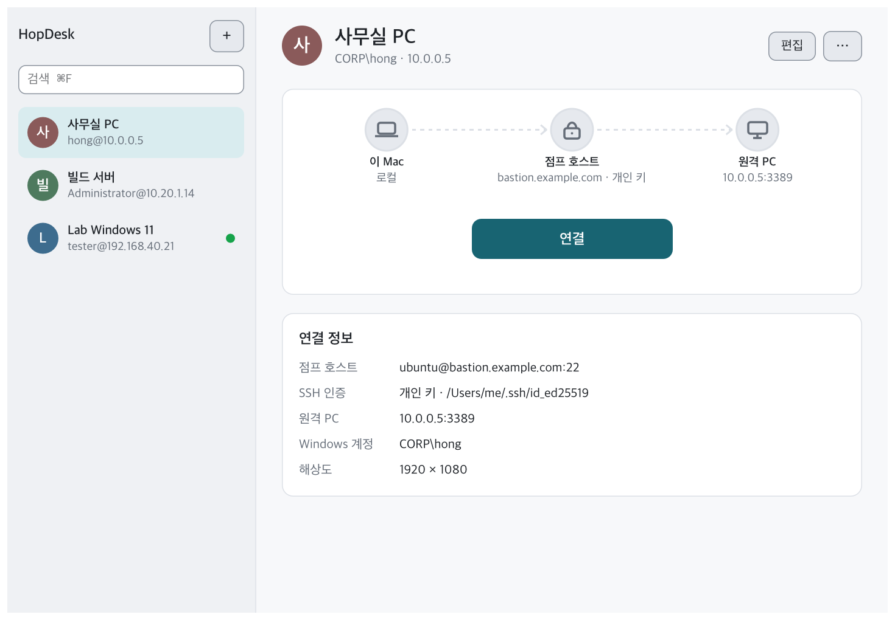
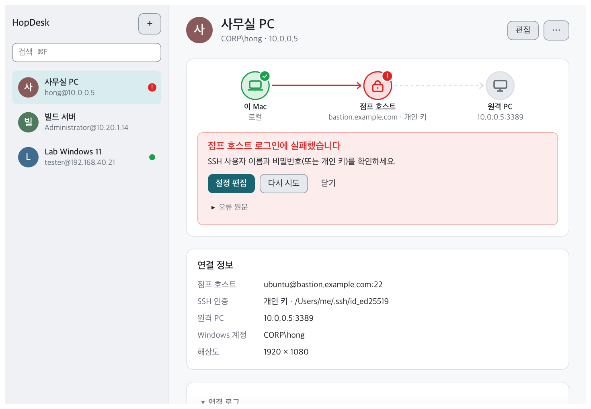
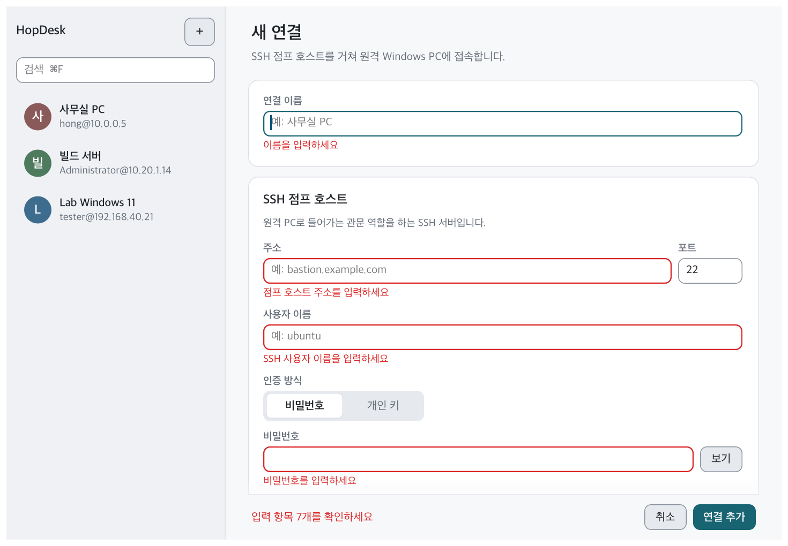

# HopDesk

SSH 점프 호스트(배스천)를 거쳐 사내망의 Windows PC에 원격 데스크톱(RDP)으로 접속하는 앱입니다. 점프 호스트 없이 바로 접속할 수도 있습니다. macOS, Windows, Linux에서 동작합니다.

터널을 따로 열고 원격 데스크톱 앱을 실행할 필요 없이, 저장한 연결을 고르고 **연결**을 누르면 됩니다.
HopDesk가 SSH 터널을 열고 저장된 계정으로 Windows에 자동 로그인합니다.



## 주요 기능

- **한 번에 접속:** 점프 호스트 SSH 로그인부터 Windows 로그인까지 자동으로 처리합니다.
- **안전한 비밀번호 보관:** 비밀번호와 개인 키 암호는 운영체제의 보안 저장소(macOS 키체인, Windows 자격 증명 관리자, Linux Secret Service)에만 저장하고, 설정 파일에는 기록하지 않습니다.
- **호스트 검증:** 처음 접속할 때 SSH 호스트 키와 RDP 서버 인증서를 기억합니다(TOFU). 이후 바뀌면 접속을 막고 경고합니다.
- **진행 상황 표시:** `이 Mac → 점프 호스트 → 원격 PC` 경로 그림에 연결 단계가 표시되고, 실패하면 어느 구간에서 막혔는지 알려 줍니다.
- **알기 쉬운 오류 안내:** 오류 원문 대신 원인과 해결 방법을 한국어로 보여 줍니다.
- **자동 재연결:** 네트워크가 끊기면 SSH 채널을 다시 열어 재접속합니다.
- **SSH 인증:** 비밀번호 또는 개인 키(암호 포함) 방식을 지원합니다.
- **자동 업데이트:** 실행할 때와 실행 중 1시간마다 새 버전을 확인해 사이드바에 알려 주고(메뉴 막대 아이콘의 **업데이트 확인**으로 바로 확인할 수도 있습니다), **업데이트**를 누르면 내려받아(SHA256 검증) 교체한 뒤 다시 시작합니다. 접속 중에는 업데이트하지 않습니다.
- **파일 주고받기:** macOS에서는 접속 창에 파일·폴더를 끌어다 놓으면 원격 클립보드로 보내 놓은 위치(탐색기 창·바탕화면)에 붙여넣습니다. 거꾸로 원격에서 파일이나 폴더를 복사(Ctrl+C)하면 이 Mac으로 내려받아 클립보드에 올리므로, 파인더 등에서 ⌘V로 붙여넣으면 됩니다. 이렇게 주고받은 내용은 공유 폴더를 더럽히지 않습니다: 받은 파일은 클립보드가 다음 복사로 넘어갈 때까지 임시 보관소에만 있고, 서버 정책 때문에 공유 폴더로 복사해 보낸 파일은 세션이 끝나면 폴더에서 지워집니다. 공유 폴더는 기본적으로 `~/HopDesk 공유`이며 연결 상세 화면의 **공유 폴더 · 변경…** 으로 위치를 바꿀 수 있습니다(**열기**로 바로 확인). 폴더에 직접 넣어 둔 파일은 세션이 끝나도 그대로 남고, 원격 탐색기의 `\\tsclient\HopDesk` 드라이브로 열 수 있습니다(서버 정책이 드라이브 리디렉션을 막으면 드라이브가 보이지 않습니다).
- **클립보드:** 로컬과 원격 사이에 텍스트를 복사·붙여넣기할 수 있습니다. macOS에서는 ⌘ 키가 원격의 Ctrl로 동작해 ⌘C·⌘V를 그대로 씁니다(시작 메뉴는 Ctrl+Esc). 원격에서 복사한 파일도 이 Mac에 그대로 붙여넣을 수 있습니다(위 **파일 주고받기** 참고).
- **백그라운드 실행 (macOS·Windows):** 런처 창을 닫아도 HopDesk는 종료되지 않고 메뉴 막대(Windows는 알림 영역)에 아이콘으로 남습니다. 아이콘 메뉴의 **HopDesk 열기**로 창을 다시 열고, **업데이트 확인**으로 새 버전을 확인하며, **종료**로 끝냅니다. macOS에서는 창이 열려 있는 동안 메뉴 막대 아이콘을 숨기고, 같은 **업데이트 확인**을 앱 메뉴(HopDesk)에 둡니다. Linux에서는 창을 닫으면 종료됩니다.
- **화면:** 라이트·다크 모드를 지원합니다. 세션은 기본으로 전체 화면으로 열리고(Ctrl+Alt+Enter로 창 모드 전환), 창 최대화나 고정 해상도도 고를 수 있습니다.

| 실패 안내 | 연결 추가 |
|---|---|
|  |  |

## 설치

[Releases](https://github.com/softkr/HopDesk/releases) 페이지에서 운영체제에 맞는 파일을 내려받습니다.

| 운영체제 | 파일 | 설치 |
|---|---|---|
| macOS 11 이상 (Apple Silicon: M1 이후) | `…-macos-apple-silicon.dmg` | dmg를 열고 HopDesk를 응용 프로그램 폴더로 끌어 놓기 |
| macOS 11 이상 (Intel) | `…-macos-intel.dmg` | 위와 같음 |
| Windows 10 / 11 (64비트) | `…-windows-x64.zip` | 압축을 풀고 `HopDesk.exe` 실행 |
| Linux (x86_64) | `…-linux-x86_64.tar.gz` | 압축을 풀고 `./install.sh` 실행 (앱 메뉴에 등록) |

앱에 코드 서명이 되어 있지 않아 처음 실행할 때 경고가 나옵니다.
- **macOS:** **시스템 설정 → 개인정보 보호 및 보안**에서 **그래도 열기**를 누릅니다.
- **Windows:** **추가 정보 → 실행**을 누릅니다.

### 소스에서 빌드

[rustup](https://rustup.rs)으로 Rust 1.95 이상을 설치한 뒤 빌드합니다.

```sh
git clone https://github.com/softkr/HopDesk.git
cd HopDesk
cargo build --release              # target/release/hopdesk
scripts/bundle-macos.sh --install  # macOS: HopDesk.app 을 만들어 /Applications 에 설치
```

Linux에서는 먼저 빌드에 필요한 패키지를 설치합니다(Debian/Ubuntu 기준).

```sh
sudo apt install pkg-config cmake libasound2-dev libfontconfig1-dev libxkbcommon-dev libwayland-dev libudev-dev libdrm-dev
```

## 사용법

1. HopDesk를 실행하고 **새 연결 만들기**(⌘N, Windows·Linux는 Ctrl+N)를 누릅니다.
2. 아래 항목을 입력하고 저장합니다(⌘S).
   - 점프 호스트의 주소, 사용자 이름, 인증 방식. 바로 접속할 PC라면 **사용 안 함 (직접 접속)**을 고릅니다(입력해 둔 점프 호스트 설정은 보관됩니다).
   - 원격 PC의 주소. 점프 호스트를 쓰면 점프 호스트에서 보이는 주소(예: `10.0.0.5`)를, 직접 접속이면 이 기기에서 보이는 주소를 입력합니다.
   - Windows 계정
3. 목록에서 연결을 고르고 **연결**(Enter)을 누릅니다. 원격 데스크톱은 별도 창으로 열립니다.

Windows와 Linux에서는 ⌘ 대신 Ctrl을 누릅니다.

| 단축키 | 동작 |
|---|---|
| Enter | 연결 |
| ⌘N | 새 연결 |
| ⌘F | 검색 |
| ⌘E | 편집 |
| ⌘S | 저장 |
| Esc | 취소 |
| ↑ / ↓ | 목록 이동 |

### 명령줄

GUI 없이 터미널에서도 사용할 수 있습니다. 하위 명령 없이 실행하면 GUI가 열립니다.

```sh
hopdesk add office --jump ubuntu@bastion.example.com:22 --jump-key ~/.ssh/id_ed25519 \
    --target 10.0.0.5:3389 --user hong --domain CORP
hopdesk add home --target pc.example.com --user hong   # --jump 없이: 직접 접속
hopdesk list
hopdesk connect office
hopdesk set-password office --rdp     # 저장된 비밀번호 변경 (--jump: 점프 호스트)
hopdesk forget bastion.example.com    # 기억한 호스트 키/인증서 삭제
hopdesk remove office
```

## 저장 위치

| 내용 | macOS | Windows | Linux |
|---|---|---|---|
| 연결 설정 (`profiles.toml`)<br>기억한 호스트 키·인증서 (`trust.toml`) | `~/Library/Application Support/HopDesk/` | `%APPDATA%\HopDesk\config\` | `~/.config/hopdesk/` |
| 비밀번호 | 키체인 | 자격 증명 관리자 | Secret Service (GNOME 키링, KWallet) |

비밀번호 항목의 서비스 이름은 `HopDesk`입니다. macOS와 Linux에서는 설정 파일을 소유자만 읽을 수 있는 권한(0600)으로 저장합니다.

## 동작 방식

```
HopDesk ──SSH──▶ 점프 호스트 ──direct-tcpip──▶ Windows PC :3389
           └──────────── TLS + CredSSP (RDP) ────────────┘
```

로컬 포트를 열지 않습니다. SSH `direct-tcpip` 채널을 RDP 연결의 전송 계층으로 바로 사용합니다.
TLS 인증서 검증과 CredSSP 인증은 실제 대상 호스트 이름을 기준으로 이루어집니다.

## 개발

```sh
cargo run                    # GUI 실행
cargo run -- connect office  # 명령줄로 접속
cargo clippy
HOPDESK_SHOTS=target/screenshots cargo test screenshots -- --ignored   # 화면 스냅숏 생성
scripts/make-icon.sh         # assets/icon/*.svg 로 아이콘 파일 생성 (resvg 필요)
```

| 경로 | 내용 |
|---|---|
| `src/main.rs` | 명령줄 인터페이스 |
| `src/tunnel.rs` | SSH 점프 호스트 터널 |
| `src/session.rs` | RDP 세션 |
| `src/trust.rs` | 호스트 키·인증서 검증 |
| `src/profile.rs` | 연결 설정과 키체인 |
| `src/gui/` | 런처 GUI (egui) |

GUI에서 연결할 때마다 `hopdesk connect <이름>`을 별도 프로세스로 실행하므로, 런처를 닫아도 열린 세션은 유지됩니다.

RDP 엔진은 [IronRDP](https://github.com/Devolutions/IronRDP)를 `third_party/`에 포함해 사용합니다.
SSH 채널을 전송 계층으로 쓰기 위한 작은 패치를 적용했으며, 자세한 내용은 [third_party/PATCHES.md](third_party/PATCHES.md)에 있습니다.

### 릴리스

`main`에 푸시하면 GitHub Actions([.github/workflows/release.yml](.github/workflows/release.yml))가 macOS(Apple Silicon·Intel 각각), Windows, Linux용 패키지를 빌드하고 릴리스를 만듭니다.
버전은 자동으로 정해집니다: 같은 `major.minor`의 마지막 태그에서 패치 번호를 1 올립니다(`v0.1.0` → `v0.1.1`).
메이저·마이너를 올리려면 `Cargo.toml`의 `version`을 바꿔 푸시합니다(예: `0.2.0`이면 다음 릴리스가 `v0.2.0`).
Actions 탭에서 수동으로 실행하면 릴리스 없이 빌드만 하고, 결과물은 실행 기록에 첨부됩니다.
릴리스 설명은 [.github/release-notes.md](.github/release-notes.md)를 바탕으로 만들어집니다.

macOS 앱은 모든 릴리스에서 같은 자체 서명 인증서로 서명합니다. 다만 Apple Team ID가 없는 앱은 키체인이 빌드마다 접근 권한을 따로 기록하므로, 업데이트한 뒤 처음 실행할 때 로그인 암호를 한 번 묻습니다(**항상 허용**을 누르면 그 버전에서는 다시 묻지 않습니다). 그래서 모든 비밀번호를 키체인 항목 하나에 모아 둡니다. 예전 버전이 비밀번호마다 따로 저장한 항목은 런처가 시작할 때 이 항목으로 옮깁니다(옮길 때 항목마다 한 번씩 묻습니다).
처음 한 번 `scripts/make-signing-cert.sh`로 인증서를 만들고, 스크립트가 안내하는 대로 저장소 Actions 시크릿 `MACOS_SIGN_P12`, `MACOS_SIGN_P12_PASSWORD`에 등록합니다. 시크릿이 없으면 macOS 빌드는 실패합니다.
인증서를 잃어버려 새로 만들면 사용자가 키체인 접근을 한 번 더 허용해야 하므로, 만든 파일은 저장소 밖에 안전하게 보관합니다.

## 라이선스

포함된 IronRDP는 MIT 또는 Apache-2.0 라이선스를 따릅니다.
